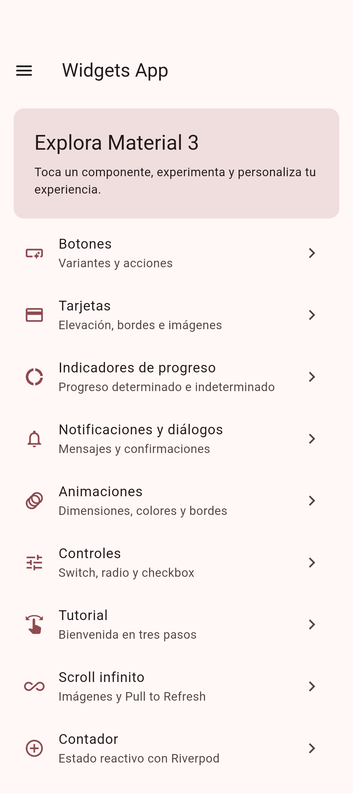
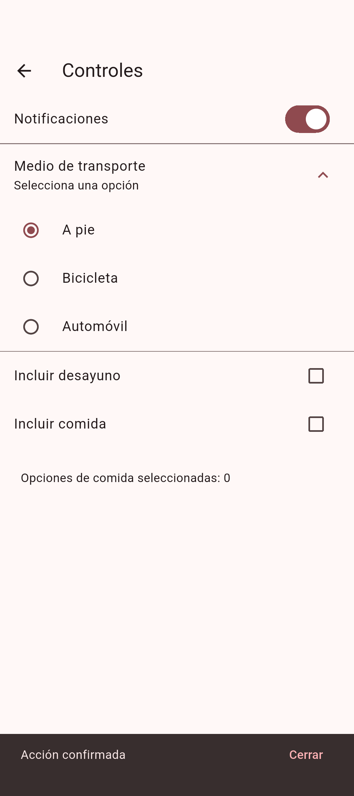
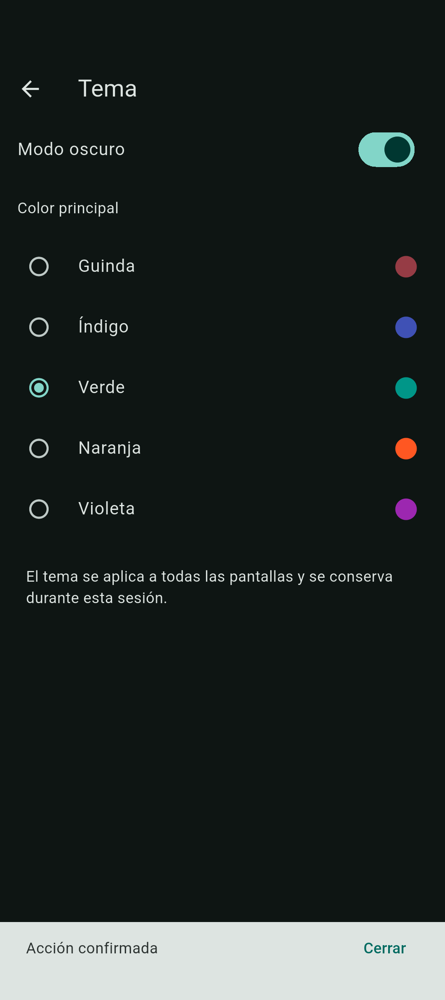

# Práctica 05 · Widgets App

**Alumno:** Angel de Jesus Baños Tellez · **Matrícula:** 230592 · **Grupo:** 10A

**Asignatura:** Desarrollo Móvil Integral · **Valor:** 40 firmas

Aplicación Flutter y Dart con diez pantallas de Material Design 3, navegación declarativa mediante GoRouter y estado reactivo con Riverpod. El proyecto está en `docs/Practica-05`.

- [Código en GitHub, rama practica05](https://github.com/AngelJdev/10A-DMI/tree/practica05/docs/Practica-05).
- [Portal de la práctica y diagramas](https://angeljdev.github.io/10A-DMI/Practica-05/).
- [Arquitectura general](arquitectura/general.html) · [Arquitectura específica](arquitectura/especifica.html).
- **Appetize: pendiente de publicación.** El navegador no pudo controlarse porque la herramienta no pudo verificar su URL. No se ha generado un enlace público de demostración.

## Instalación y ejecución

Se utilizó Flutter **3.47.2**, Dart **3.13.2** y un emulador Android 17 (API 37). Se necesita Flutter en PATH y Android SDK para Android. Las imágenes remotas requieren Internet; las demás demostraciones funcionan sin conexión.

Desde la raíz del repositorio:

```powershell
cd docs/Practica-05
flutter pub get
flutter run -d emulator-5554
```

Usa `flutter devices` para elegir otro dispositivo. El repositorio incluye un SDK local en `flutter`; si no está en PATH, usa `../../flutter/bin/flutter.bat` en lugar de `flutter`. VS Code incluye la configuración **Práctica 05 (Widgets App)**.

```powershell
flutter analyze
flutter test
flutter drive --driver=test_driver/integration_test.dart --target=integration_test/app_test.dart -d emulator-5554
flutter build apk --release
```

Ejecuta los comandos Flutter de forma secuencial. Si una compilación release menciona un plugin de integration_test inexistente, repite `flutter build apk --release` sin otras tareas Flutter concurrentes; es un [conflicto de generación documentado en Flutter](https://github.com/flutter/flutter/issues/193430).

El APK queda en `build/app/outputs/flutter-apk/app-release.apk`. La compilación release usa la firma de depuración configurada para esta práctica; sirve para instalar y demostrar, no para publicar en una tienda. El flujo [Validar Widgets App](../../.github/workflows/practica05.yml) también genera un APK descargable como artefacto.

## Pantallas y requisitos

| Ruta | Demostración |
|---|---|
| `/` | Scaffold, AppBar, ListView.builder, ListTile y NavigationDrawer agrupado; catálogo central en menuItems |
| `/buttons` | Elevated, Filled, Outlined, Text, IconButton, FloatingActionButton, estados deshabilitados e InkWell sobre Material |
| `/cards` | Elevaciones 0–5, bordes, superficie de color e imágenes de Unsplash con alternativa ante errores |
| `/progress` | Circular y LinearProgressIndicator indeterminados y determinados; Stream.periodic y StreamBuilder |
| `/dialogs` | SnackBar con acción, ScaffoldMessenger, showDialog, AlertDialog, confirmar, cancelar y showAboutDialog |
| `/animated` | AnimatedContainer con dimensiones, color y radio aleatorios; curva y duración de 700 ms |
| `/controls` | SwitchListTile, RadioListTile, CheckboxListTile, ExpansionTile, setState y enum Transport |
| `/tutorial` | PageView, PageController, tres imágenes PNG locales, FadeInRight, anterior, siguiente, omitir y comenzar |
| `/infinite` | ListView.builder, ScrollController, lotes asíncronos de 8 imágenes, FadeInImage, NetworkImage y GIF local |
| `/counter` | ConsumerWidget, StateProvider, ref.watch y ref.read; incrementar, disminuir y reiniciar |
| `/theme` | ThemeNotifier, StateNotifierProvider, RadioListTile, cinco colores y modo claro/oscuro |

Pull to Refresh reemplaza el lote de la galería. Una marca de generación impide que una carga anterior agregue datos después de refrescar. Se comprueba `mounted` al completar operaciones asíncronas y se liberan los controladores en `dispose`.

El contador y el tema sobreviven a la navegación durante una sesión de `ProviderScope`. Al cerrar y volver a iniciar se restablecen; no se requiere una base de datos ni un servidor propio. Los radios usan RadioGroup para evitar las propiedades de selección obsoletas de RadioListTile.

En Riverpod 3, StateProvider y StateNotifierProvider están en `flutter_riverpod/legacy.dart`; se utilizan porque la consigna los solicita expresamente. [Documentación oficial](https://riverpod.dev/docs/whats_new).

## Organización

```text
lib/
  main.dart                     # ProviderScope + ConsumerWidget + MaterialApp.router
  config/                       # AppTheme, GoRouter y catálogo menuItems
  providers/app_providers.dart  # contador y ThemeNotifier
  screens/                      # inicio y diez demostraciones
  widgets/                      # AppDrawer, DemoScaffold y mensajes reutilizables
assets/images/                  # tres PNG del tutorial y loading.gif animado
integration_test/               # recorrido Android y capturas
test_driver/                   # guarda capturas en evidencias/
test/                           # once pruebas de widgets
arquitectura/                   # dos HTML Archify, fuentes JSON y comprobaciones
```

## Arquitectura con Archify

Los diagramas se generaron con **Archify 3.2.0**, del [proyecto oficial](https://github.com/tt-a1i/archify). Los nodos enlazan al código de la aplicación fijado al commit `71922ebc593855c2a538f80ae72e89f19ab141eb`.

- **General:** usuario, app Flutter/Material 3, GoRouter, pantallas, Riverpod, recursos locales e imágenes HTTPS.
- **Específica:** inicio y drawer, diez pantallas y rutas, contador, ThemeNotifier, recursos del tutorial y Picsum.
- Fuentes editables: [general.architecture.json](arquitectura/general.architecture.json) y [especifica.architecture.json](arquitectura/especifica.architecture.json).
- Las comprobaciones automáticas de estructura, entrega, artefacto y navegador pasaron para ambos diagramas. No se realizó una revisión visual manual de los diagramas. Los recibos `*.finalize-summary.json` documentan los resultados.

Para regenerarlos desde la raíz, con el paquete oficial de Archify disponible:

```powershell
node RUTA/archify/bin/archify.mjs finalize architecture docs/Practica-05/arquitectura/general.architecture.json docs/Practica-05/arquitectura/general.html --repo-root . --quality showcase --json
node RUTA/archify/bin/archify.mjs finalize architecture docs/Practica-05/arquitectura/especifica.architecture.json docs/Practica-05/arquitectura/especifica.html --repo-root . --quality showcase --json
```

El flujo `pages.yml` publica `docs` en GitHub Pages al subir a `main` o `practica05`. La URL del portal requiere que el despliegue de GitHub Actions haya terminado correctamente.

## Evidencias y verificación

Las once pruebas de widgets cubren navegación, drawer, contador entre rutas, cambio de tema, confirmación/cancelación, controles, tutorial, progreso y salida de la galería mientras carga. `flutter analyze` terminó sin observaciones.

El recorrido de integración abre las diez demostraciones en Android, interactúa con botones, contador, tema, animación, diálogos y Pull to Refresh, y genera capturas reales mediante `integration_test`.

| Inicio | Controles | Tema |
|---|---|---|
|  |  |  |

Consulta [evidencias](evidencias/) para las capturas de todas las pantallas y el registro de verificación.

## Completar la demo de Appetize

1. Abre tu cuenta de Appetize y crea una app Android para **Widgets App**.
2. Sube `build/app/outputs/flutter-apk/app-release.apk` o el APK del artefacto de GitHub Actions.
3. Inicia una sesión y verifica las pantallas y las imágenes remotas.
4. Sustituye el estado pendiente de este README y del portal por el enlace público de la demo.

La práctica no debe considerarse entregada al 100 % hasta que exista ese enlace y se haya verificado la publicación del portal.
