# Práctica 04 — TikiTiki

TikiTiki es una aplicación de videos cortos inspirada en TikTok. Permite recorrer videos, dar Me gusta, guardar favoritos y consultar el perfil. Su apariencia cambia según la fecha: conserva un diseño original durante el año y utiliza estilos especiales para Halloween, Navidad y San Valentín.

**Estudiante:** Angel de Jesus Baños Tellez · **Matrícula:** 230592 · **Grupo:** 10A

**Materia:** Desarrollo Móvil Integral (DMI)

**Docente:** M.T.I. Marco A. Ramírez Hernández

**Periodo:** Septiembre – Diciembre de 2026

## 1. Objetivo

Desarrollar una aplicación móvil que permita reproducir videos y realizar interacciones básicas de una red social. La práctica también busca personalizar la experiencia según la temporada y conservar los Me gusta y favoritos después de cerrar la aplicación.

La documentación presenta primero el funcionamiento y las capturas del resultado. Al final se incluyen las instrucciones de ejecución y una referencia breve de la organización del código.

## 2. ¿Qué se puede hacer?

| Función | Cómo se utiliza |
|---|---|
| Ver videos | Deslizar hacia arriba o abajo para cambiar de video. Un toque permite pausar o continuar. |
| Explorar secciones | Cambiar entre **Discover**, **For You** y **Favorites** con las pestañas superiores o deslizando lateralmente. |
| Dar Me gusta | Tocar el botón lateral o dar doble toque al video. El icono y la animación cambian con la temporada. |
| Consultar el perfil | Abrir **Perfil** para ver la colección de videos marcados con Me gusta. |
| Guardar favoritos | Pulsar **Guardar** para añadir el video a **Favorites**. Es una colección distinta a los Me gusta del perfil. |
| Comentar | Abrir el botón de comentarios para consultar y agregar texto. |
| Controlar el audio | Pulsar **Audio/Silencio** para activar o silenciar los videos. El botón superior permite reproducir el efecto de temporada. |
| Leer la descripción | Pulsar **más** para ampliar el texto y **Ocultar** para volver a la vista breve. |
| Cambiar de temporada | Utilizar la fecha del dispositivo o tocar el logo superior para abrir el selector de temas. |

El contenido combina archivos incluidos en el proyecto y videos de demostración disponibles en línea. Los archivos incluidos pueden reproducirse sin descargar el video; el contenido en línea necesita conexión a Internet.

## 3. Capturas y resultado visual

Las imágenes siguientes corresponden a las capturas agregadas al proyecto. Se ordenaron para mostrar el acceso a la app, la navegación, las interacciones y las diferencias entre temporadas.

### 3.1. Icono original de TikiTiki

<p align="center">
  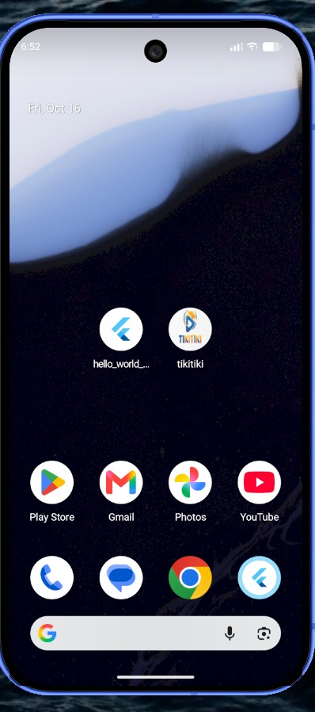
</p>

**Figura 1. Acceso a la aplicación.** El icono original conserva el símbolo de reproducción, el birrete y los colores azul y naranja. Esta imagen muestra cómo se identifica TikiTiki antes de abrirla.

### 3.2. Pantalla principal y perfil en Halloween

| Pantalla de videos | Perfil y Me gusta |
|:---:|:---:|
| 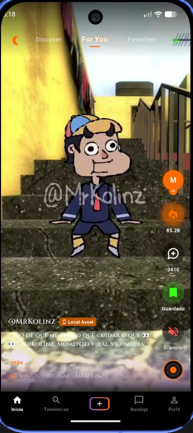 | 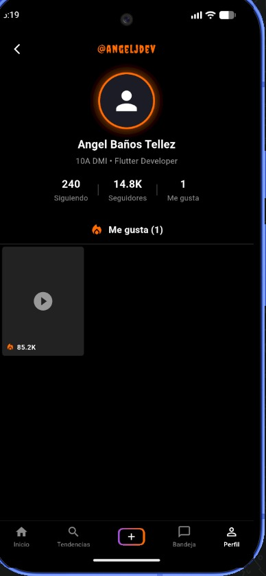 |
| **Figura 2. Video e interacciones.** | **Figura 3. Colección del perfil.** |

En **For You** se reproduce un video de MrKolinz y aparecen los controles de Me gusta, comentarios, guardado y sonido. El estilo de Halloween utiliza detalles naranjas y morados, una llama para los Me gusta y una tipografía decorativa.

La segunda captura muestra el perfil con **Me gusta (1)** y un video dentro de esa colección. Ese número indica cuántos videos ha marcado el usuario; el contador de la miniatura corresponde a los likes del video.

Aunque el archivo de la figura 2 se llama `tiktokApi.jpeg`, la pantalla muestra la etiqueta **Local Asset**. La captura documenta un video incluido en el proyecto, no una llamada a la API de TikTok. Del mismo modo, `perfil_guardado.jpeg` muestra la colección de **Me gusta**, no la pestaña **Favorites**.

### 3.3. Exploración de contenido en Discover

| Vista etiquetada Local Asset | Vista etiquetada YouTube |
|:---:|:---:|
| 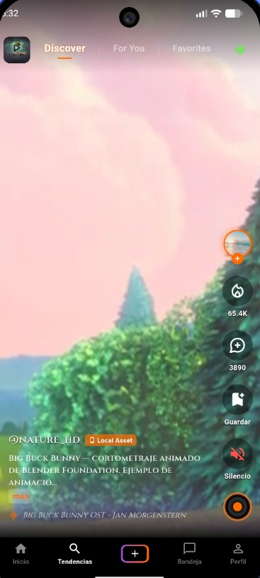 | 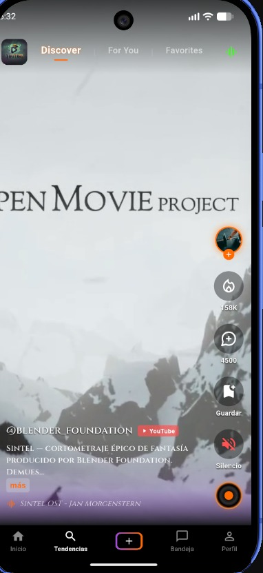 |
| **Figura 4. Big Buck Bunny en Discover.** | **Figura 5. Sintel en Discover.** |

Estas capturas muestran la sección **Discover**, la reproducción vertical y la información del autor, descripción y sonido. También se aprecia el botón **más**, que permite ampliar las descripciones largas, y el estado **Silencio** del reproductor.

Las etiquetas son las que muestra la interfaz. En la versión actual, los videos de demostración de estas fuentes se obtienen mediante enlaces públicos; la etiqueta **YouTube** no significa que se esté utilizando su API oficial. La etiqueta **Local Asset** tampoco basta por sí sola para demostrar que el archivo está almacenado en el dispositivo.

### 3.4. Diseño de Navidad

| Pantalla principal | Perfil |
|:---:|:---:|
| 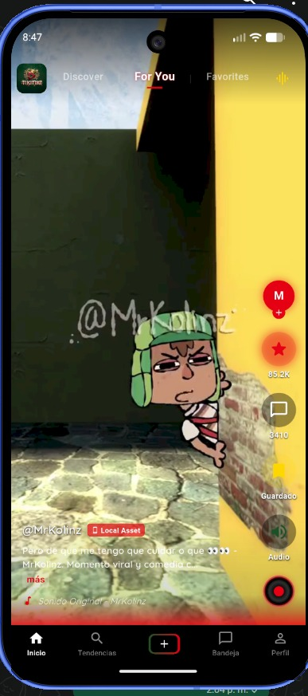 | 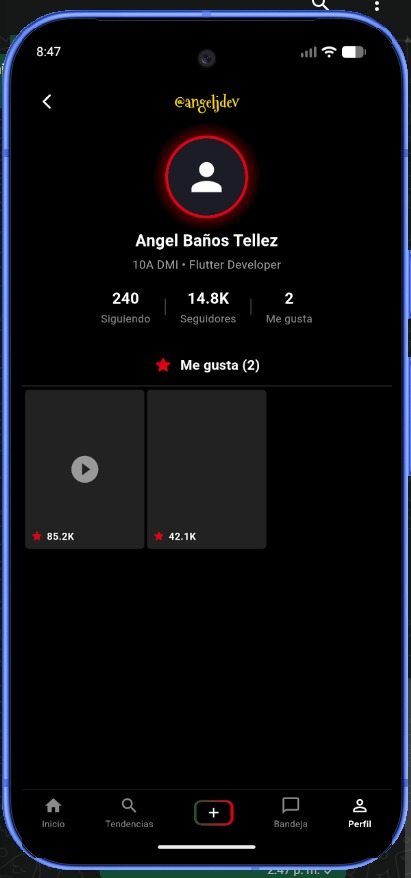 |
| **Figura 6. Reproducción con estilo navideño.** | **Figura 7. Perfil con estilo navideño.** |

El diseño navideño cambia el logo superior, los colores de los controles, la tipografía y el icono de Me gusta, que pasa de una llama a una estrella. Los detalles rojos, verdes y dorados distinguen esta temporada.

En el perfil se observa el nombre con otra tipografía, el borde rojo del avatar y la sección **Me gusta (2)** con dos videos. La comparación con Halloween permite apreciar cómo la misma función adopta una presentación diferente.

### 3.5. Diseño de San Valentín y prueba de Me gusta

<p align="center">
  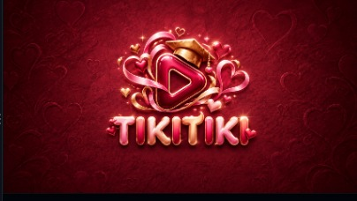
</p>

**Figura 8. Logo de San Valentín.** Esta variante conserva el símbolo de TikiTiki y añade corazones, listones y tonos rojos y rosas. El mismo estilo se utiliza en el logo superior de la app y en su icono estacional de Android.

| Antes de dar Me gusta | Después de dar Me gusta |
|:---:|:---:|
| 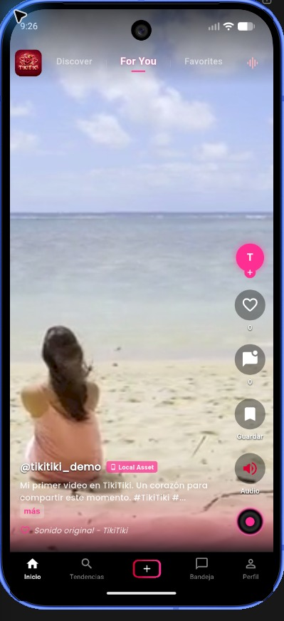 | 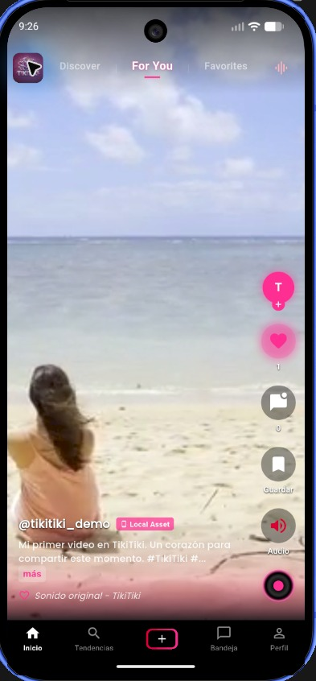 |
| **Figura 9. Video con 0 likes.** | **Figura 10. El mismo video con 1 like.** |

Las dos capturas muestran el mismo video de **@tikitiki_demo**. Antes de la interacción, el corazón está vacío y el contador indica **0**. Al pulsarlo, el corazón se rellena de rosa, aparece un resplandor a su alrededor y el contador sube a **1**.

También se aprecian el logo de corazones, el degradado rosa en la parte inferior y los detalles de color en el avatar y los controles. La navegación y la reproducción mantienen su funcionamiento mientras cambia la apariencia.

| Perfil de San Valentín | Icono en Android |
|:---:|:---:|
| 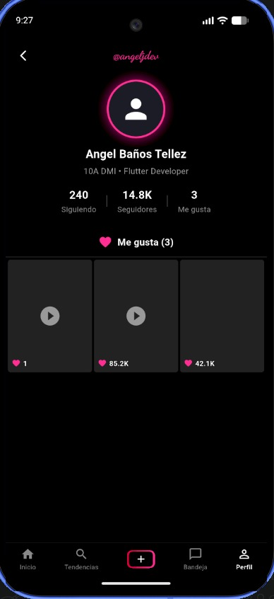 | 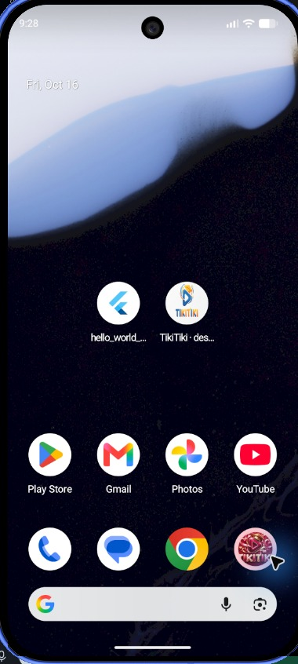 |
| **Figura 11. Video añadido al perfil.** | **Figura 12. Icono estacional antes de abrir la app.** |

En el perfil aparece **Me gusta (3)** porque la colección contiene el video nuevo y dos videos marcados anteriormente. La primera miniatura muestra **1 like**, correspondiente al video de demostración. Se distinguen además el nombre en cursiva, el borde rosa del avatar y los corazones de la temporada.

En la pantalla de inicio de Android, el icono rosa de San Valentín se encuentra en la parte inferior derecha. El acceso **TikiTiki · desarrollo**, situado junto a la otra app de Flutter, conserva el logo azul y naranja: es la entrada de depuración, distinta del acceso estacional.

### 3.6. Resumen de las evidencias

| Aspecto documentado | Evidencia incluida |
|---|---|
| Identidad original | Icono de TikiTiki en Android, figura 1. |
| Diseño de Halloween | Pantalla de videos y perfil, figuras 2 y 3. |
| Exploración de contenido | Dos vistas de Discover, figuras 4 y 5. |
| Diseño de Navidad | Pantalla de videos y perfil, figuras 6 y 7. |
| Diseño de San Valentín | Logo, pantalla de videos, perfil e icono de Android, figuras 8 a 12. |
| Incremento de Me gusta | El mismo video pasa de 0 a 1 y aparece en el perfil, figuras 9 a 11. |

Las capturas anteriores con contadores como **85.2K** muestran el diseño de otras temporadas; las figuras 9 y 10 corresponden a la prueba preparada desde cero. Las imágenes adjuntas comprueban el incremento y la incorporación al perfil. No se adjuntó una captura identificada como posterior al cierre y reapertura; la sección 5 explica cómo comprobar ese paso de persistencia.

El audio y el movimiento de las animaciones se comprueban usando la app o mediante una grabación de pantalla. Las funciones de favoritos, comentarios, descripción ampliada y selector de temporadas se explican en el documento, aunque no cuentan con capturas específicas en esta galería.

## 4. Diseños según la fecha

Al iniciar en modo automático, la aplicación consulta la fecha del dispositivo y elige el estilo correspondiente. Los días inicial y final de cada periodo están incluidos.

| Estilo | Periodo | Cambios principales |
|---|---|---|
| Original | Fuera de las fechas especiales | Logo azul y naranja; interfaz oscura, corazón de Me gusta y presentación habitual. |
| Halloween | 15 de octubre al 5 de noviembre | Logo de Halloween, tonos naranjas y morados, letras decorativas y llama de Me gusta. |
| Navidad | 10 de diciembre al 6 de enero | Logo navideño, rojo, verde y dorado, tipografía navideña y estrella de Me gusta. |
| San Valentín | 1 al 14 de febrero | Logo con corazones, tonos rosas y rojos, letras cursivas y corazón de Me gusta. |

Cada temporada tiene un sonido de entrada y modifica los detalles visuales de la aplicación. El tema también se puede elegir manualmente desde el logo superior; esa selección se conserva hasta volver a **Automático**.

### Cómo cambiar la fecha para tomar capturas

El archivo que se modifica es [lib/core/theme/season_date_config.dart](lib/core/theme/season_date_config.dart). Buscar la variable `simulatedSeasonDate` y dejar **una sola declaración** con la fecha deseada:

| Diseño que se quiere mostrar | Valor de ejemplo |
|---|---|
| Original | `DateTime(2026, 7, 10)` |
| Halloween | `DateTime(2026, 10, 20)` |
| Navidad | `DateTime(2026, 12, 20)` |
| San Valentín | `DateTime(2026, 2, 10)` |
| Fecha real del dispositivo | `null` |

Por ejemplo, para Navidad:

```dart
final DateTime? simulatedSeasonDate = DateTime(2026, 12, 20);
```

Para volver a la fecha real:

```dart
final DateTime? simulatedSeasonDate = null;
```

1. Guardar el archivo.
2. Detener por completo la ejecución y volver a iniciar con `flutter run`.
3. Capturar la pantalla de videos y el perfil.
4. Presionar **Inicio** en Android para que se aplique el icono estacional y esperar a que se actualice.
5. Capturar el icono desde la pantalla de inicio o el listado de aplicaciones.

La fecha simulada tiene prioridad al iniciar. Al regresar a `null`, seleccionar **Automático** si antes se eligió un tema manualmente. El icono se actualiza después de ejecutar la app y pasarla a segundo plano.

Durante el desarrollo puede aparecer un segundo acceso llamado **TikiTiki · desarrollo**. Es la entrada fija para ejecutar y depurar la app; para documentar el cambio de icono se utiliza el acceso estacional. El acceso adicional no forma parte de la versión de distribución.

## 5. Me gusta y datos guardados

Los Me gusta y los favoritos se conservan en el dispositivo. Al cerrar y volver a abrir la app, se recupera el estado guardado. Esto permite comprobar que las interacciones permanecen entre sesiones.

**Me gusta** y **Guardar** tienen funciones diferentes: el primero marca el video y lo añade a la colección del perfil; el segundo lo agrega a **Favorites**.

### Comprobación del like de 0 a 1

El primer video, de **@tikitiki_demo**, está configurado para iniciar en **0 likes** cuando no existe un valor anterior guardado para ese video. Tiene un identificador propio, por lo que no hereda los contadores de las capturas anteriores. El valor no se reinicia al abrir la app.

Las figuras 9 y 10 muestran el cambio de **0 a 1** y la figura 11 muestra el video dentro de la colección del perfil. Para repetir la prueba y comprobar también que el like permanece después de cerrar la app:

1. Abrir el primer video y capturar el contador en **0**, sin marcar.
2. Pulsar Me gusta y capturar el contador en **1**, con el icono activado.
3. Cerrar completamente la aplicación y volver a abrirla, sin borrar sus datos.
4. Regresar al mismo video y capturar que continúa con **1 like** y el icono activado.
5. Revisar el perfil para comprobar que el video aparece en la colección de Me gusta.

Si ya existe un like guardado, no se debe esperar que el contador vuelva a cero con cada arranque. Quitar ese like permite repetir la secuencia en el video de prueba. Borrar los datos o desinstalar la app también elimina las preferencias y demás interacciones guardadas.

Al reabrir, el resultado esperado es que el mismo video siga mostrando **1** y el corazón marcado. Ese paso comprueba la persistencia entre sesiones; consultar el perfil durante una misma sesión comprueba la actualización de la colección.

## 6. Cómo ejecutar la práctica

Se necesita Flutter configurado y un emulador Android o un teléfono conectado.

Desde la carpeta principal del repositorio:

```powershell
cd docs/practica04/tikitiki
flutter pub get
flutter run
```

Si la terminal ya está dentro de `tikitiki`, basta con ejecutar los dos últimos comandos. La práctica se ha comprobado en un emulador Android; el cambio del icono estacional está implementado para esa plataforma.

Para actualizar una fecha simulada se recomienda detener y volver a ejecutar la aplicación. Para repetir las capturas de persistencia se debe conservar la instalación y sus datos.

## 7. Diagramas de arquitectura

Los siguientes diagramas presentan dos formas de ejecutar la misma práctica: la instalación local que ya se utiliza para las capturas y el despliegue previsto en Appetize para probarla desde un navegador.

### Diagrama 1. Arquitectura actual: ejecución local

TikiTiki se ejecuta dentro de un teléfono Android o del emulador instalado en la computadora. Las pantallas muestran los videos y envían las interacciones al estado de la app. El repositorio reúne la información de los videos con los likes, favoritos y comentarios guardados en ese dispositivo.

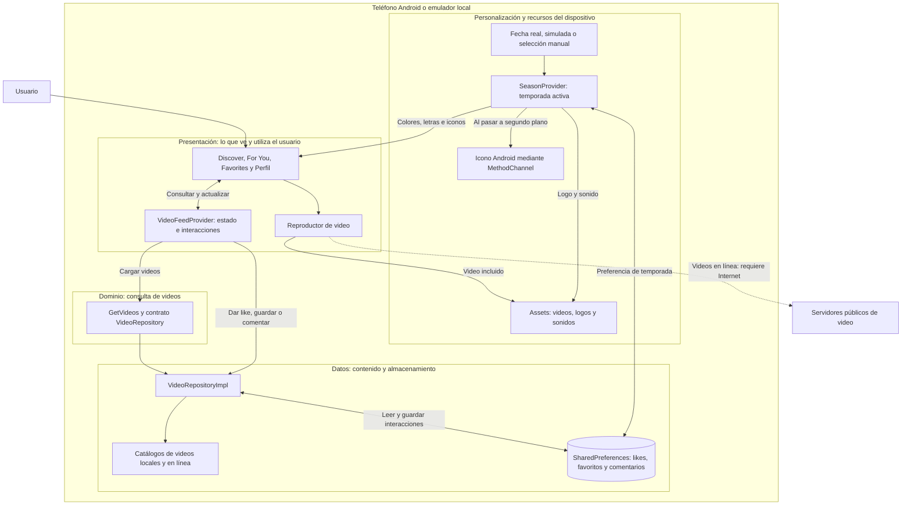

**Cómo leerlo:** las acciones parten de las pantallas; el estado coordina los cambios y el repositorio guarda o recupera los datos. El reproductor abre los archivos incluidos o los enlaces de video. La temporada se decide de forma independiente y cambia la presentación de esas mismas pantallas.

En esta versión, los likes permanecen en el almacenamiento del teléfono o emulador donde se utiliza la app. Los videos incluidos están dentro del proyecto; los videos en línea requieren conexión. No existe un servidor propio que sincronice las interacciones entre distintos dispositivos.

### Diagrama 2. Arquitectura prevista: ejecución en Appetize

**Estado: despliegue pendiente.** Este diagrama describe la siguiente etapa de la práctica; todavía no representa una aplicación publicada ni un enlace de acceso disponible.

Appetize permite cargar un archivo **APK** y ejecutar la aplicación Android en un emulador remoto, al que se accede desde el navegador. La app sigue siendo móvil y conserva su organización interna; cambia el lugar donde se ejecuta. Referencias oficiales: [carga de aplicaciones Android](https://docs.appetize.io/platform/app-management/uploading-apps/android) y [emuladores utilizados por Appetize](https://support.appetize.io/does-appetize.io-use-emulators-or-physical-devices).

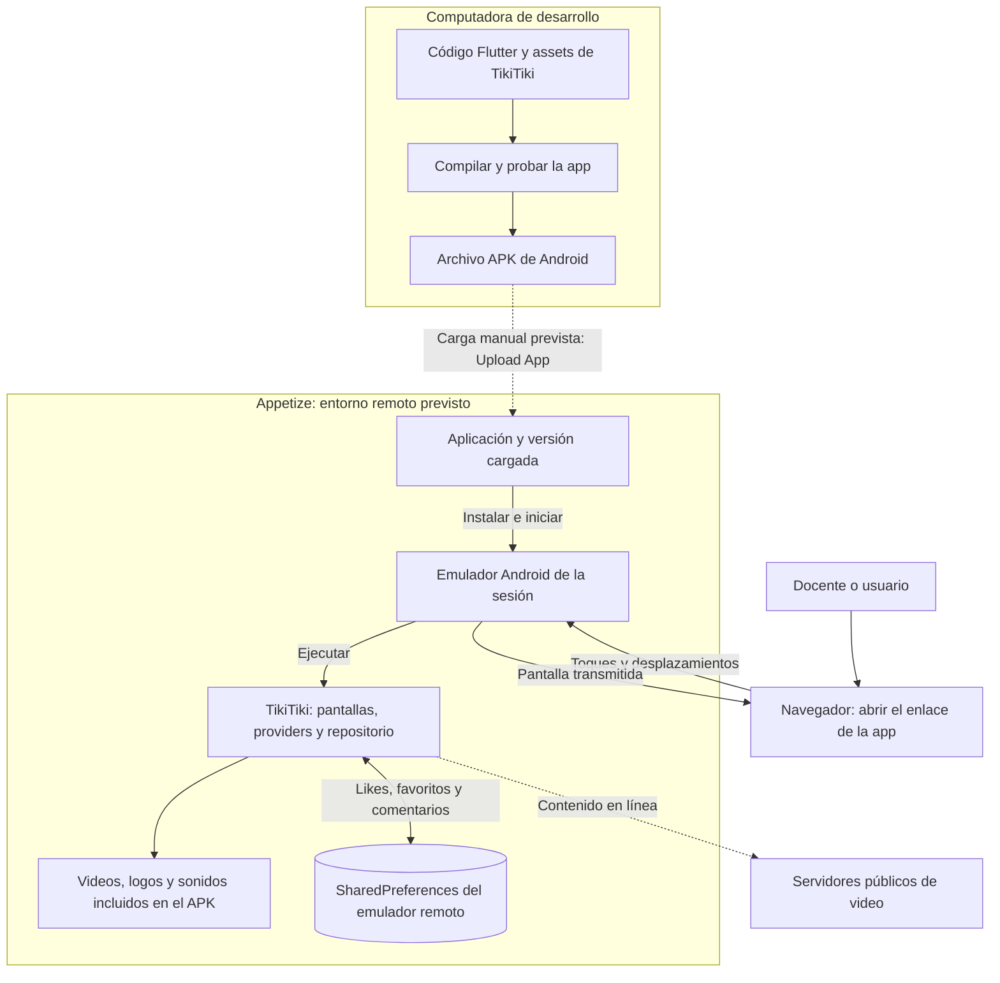

**Qué cambia:** la computadora genera el APK y Appetize lo ejecuta en su emulador. Quien abre el enlace ve y controla la app desde el navegador. No se convierte el proyecto en una página web ni se añade una base de datos compartida; el almacenamiento sigue perteneciendo a la instalación Android que ejecuta TikiTiki.

Los likes existentes en el emulador local no se incluyen en el APK ni se trasladan automáticamente al emulador de Appetize. Para comprobar la persistencia durante la demostración, se debe cerrar y reabrir la app dentro de la misma sesión del emulador remoto, conservando sus datos. La conservación entre sesiones distintas deberá verificarse al preparar el despliegue.

La siguiente etapa será generar y probar el APK, cargarlo con **Upload App**, iniciar una sesión Android y comprobar videos, temporadas y Me gusta. Después se añadirá aquí el enlace real y las capturas de la ejecución en Appetize. La [guía oficial para ejecutar aplicaciones](https://docs.appetize.io/platform/app-management/running-apps) describe la página de acceso y sus controles.

## 8. Organización y comprobaciones

La aplicación se desarrolló con **Flutter y Dart**. El código separa las pantallas, la información de los videos y el almacenamiento de las interacciones para facilitar los cambios y el mantenimiento.

En las verificaciones realizadas durante el desarrollo se registraron **10 pruebas aprobadas**, análisis sin incidencias y compilación correcta del APK de depuración. También se comprobó el arranque en el emulador y la activación de los iconos de Navidad y San Valentín. Estas comprobaciones complementan las 12 figuras de la galería; la sección 3.6 distingue lo que muestran las capturas de lo que se comprueba al utilizar la app.

<details>
<summary>Ver referencia del código y comprobaciones</summary>

### Archivos principales

| Archivo o carpeta | Para qué sirve |
|---|---|
| [lib/main.dart](lib/main.dart) | Inicia la app y conecta sus secciones. |
| [lib/core/theme/season_date_config.dart](lib/core/theme/season_date_config.dart) | Define los periodos de cada temporada y la fecha de prueba. |
| [lib/core/theme/season_theme.dart](lib/core/theme/season_theme.dart) | Reúne colores, tipografías, logos, iconos y sonidos de cada estilo. |
| [lib/presentation/providers/season_provider.dart](lib/presentation/providers/season_provider.dart) | Selecciona la temporada y coordina el sonido y el icono. |
| [lib/presentation/providers/video_feed_provider.dart](lib/presentation/providers/video_feed_provider.dart) | Mantiene actualizadas las listas y las interacciones de los videos. |
| [lib/core/utils/storage_service.dart](lib/core/utils/storage_service.dart) | Guarda y recupera likes, favoritos, comentarios y tema manual. |
| [lib/data/datasources/local_video_datasource.dart](lib/data/datasources/local_video_datasource.dart) | Define los videos incluidos y sus contadores iniciales. |
| [lib/data/datasources/](lib/data/datasources/) | Contiene las fuentes locales y de contenido en línea. |
| [lib/data/repositories/video_repository_impl.dart](lib/data/repositories/video_repository_impl.dart) | Combina los videos con las interacciones guardadas. |
| [lib/presentation/](lib/presentation/) | Contiene las pantallas y los controles visibles. |
| [assets/](assets/) | Incluye imágenes, audios y videos. |
| [test/](test/) | Contiene las pruebas del calendario, almacenamiento y formato de contadores. |

Los paquetes principales son `provider` para actualizar la interfaz, `video_player` para reproducir los videos, `shared_preferences` para guardar las interacciones, `audioplayers` para los sonidos y `google_fonts` para las tipografías. Las dependencias completas están en [pubspec.yaml](pubspec.yaml).

Los modelos se convierten en entidades mediante un mapper. Esta separación corresponde a la organización por capas de la práctica. Los gestos permiten pausar y dar doble toque; las animaciones y los gradientes acompañan cada temporada; los videos y el disco de música utilizan repetición en bucle.

### Comandos de comprobación

```powershell
flutter analyze
flutter test
flutter build apk --debug
```

</details>

## 9. Aprendizaje de la práctica

TikiTiki reúne reproducción de video, navegación, personalización por fecha y almacenamiento local en una misma aplicación. Las capturas permiten comparar Halloween, Navidad y San Valentín, observar el icono estacional en Android y seguir el cambio de un video de **0 a 1 like** hasta su aparición en el perfil. La conservación de las interacciones entre sesiones completa la práctica de almacenamiento de datos.
