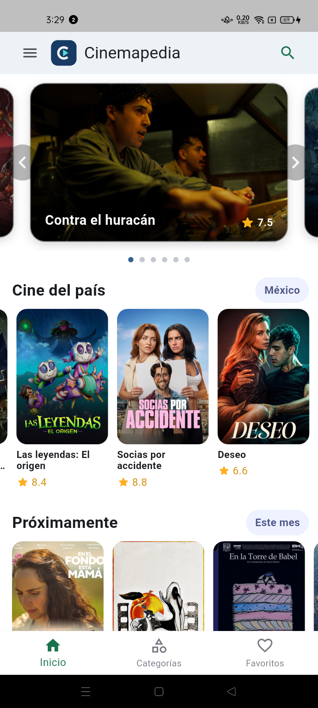
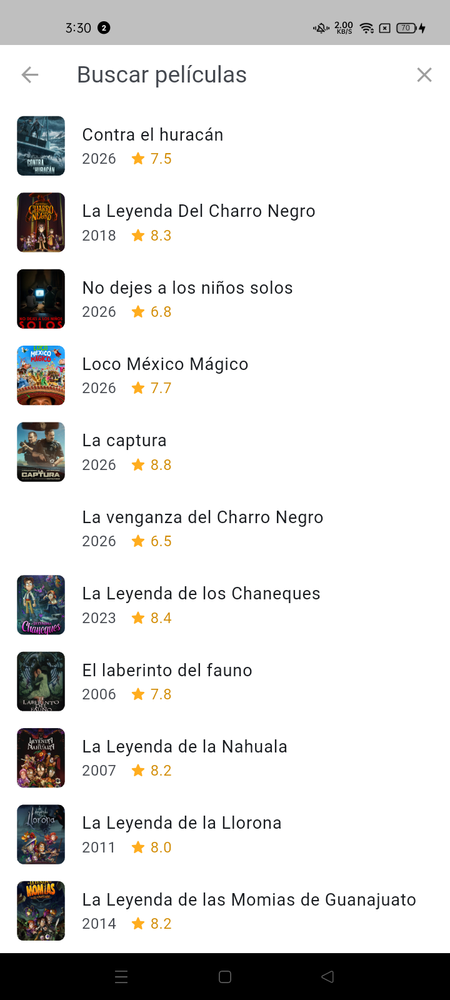
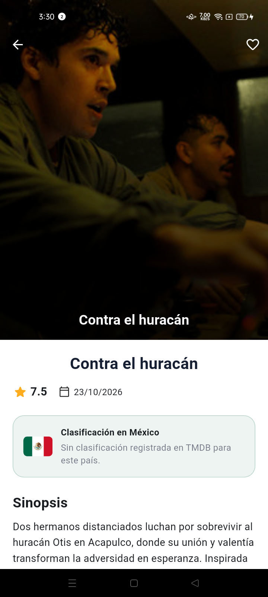
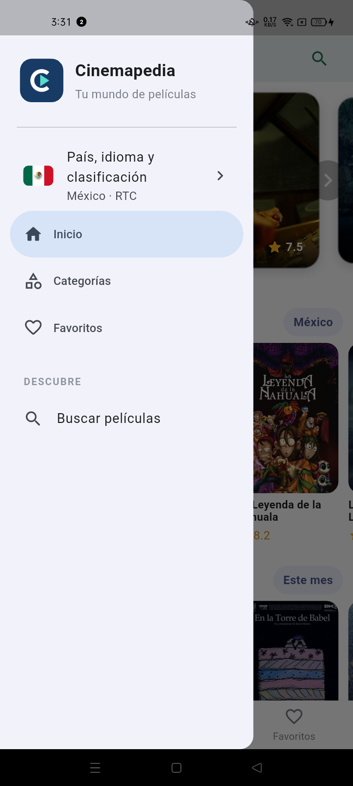
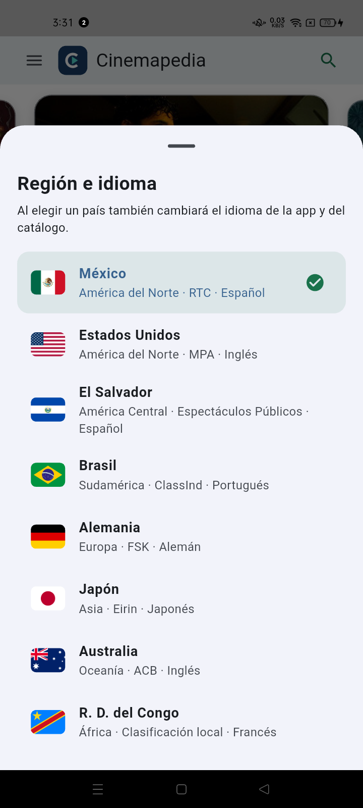

# Práctica 06 — Cinemapedia

Cinemapedia es una aplicación Flutter para consultar y explorar películas mediante la API de [The Movie Database (TMDB)](https://www.themoviedb.org/). El proyecto aplica una arquitectura por capas para separar la lógica de dominio, el acceso a datos y la interfaz de usuario.

## Funcionalidades

- Catálogo de películas populares y estrenos con carga progresiva.
- Búsqueda de películas y consulta de información detallada.
- Reproducción de tráileres mediante YouTube.
- Selección regional con idioma y contenido adaptado por país.
- Reseñas locales persistentes para cada película.
- Interfaz Material 3 adaptable, carruseles y animaciones.

## Capturas de la aplicación

<table>
  <tr>
    <td align="center"><strong>Pantalla de inicio</strong></td>
    <td align="center"><strong>Catálogo regional</strong></td>
    <td align="center"><strong>Búsqueda</strong></td>
  </tr>
  <tr>
    <td></td>
    <td></td>
    <td></td>
  </tr>
  <tr>
    <td align="center"><strong>Detalle de película</strong></td>
    <td align="center"><strong>Menú de navegación</strong></td>
    <td align="center"><strong>Región e idioma</strong></td>
  </tr>
  <tr>
    <td></td>
    <td></td>
    <td></td>
  </tr>
</table>

La pantalla principal reúne el carrusel destacado, el cine del país seleccionado y los próximos estrenos. La búsqueda muestra resultados con año y calificación; el detalle incorpora portada, favoritos, clasificación regional y sinopsis. Desde el menú se accede a categorías, favoritos, búsqueda y a la configuración de país e idioma.

## Tecnologías

- Flutter y Dart.
- Riverpod para estado e inyección de dependencias.
- GoRouter para navegación.
- Dio para consumir la API de TMDB.
- SharedPreferences para persistencia local.
- YouTube Player IFrame para reproducir tráileres.

## Arquitectura

El código de `lib` se organiza en tres capas principales:

```text
lib/
├── domain/          # Entidades y contratos de repositorios
├── infrastructure/  # API, modelos, mapeadores y repositorios
└── presentation/    # Pantallas, providers y widgets
```

## Configuración

La aplicación requiere una clave de TMDB. Crea el archivo `.env` en esta carpeta con el siguiente contenido:

```env
THE_MOVIEDB_KEY=tu_clave_de_tmdb
```

No publiques una clave real en el repositorio.

## Ejecución

Desde la raíz del repositorio:

```powershell
cd docs/practica06
flutter pub get
flutter run
```

Para ejecutar en un dispositivo específico:

```powershell
flutter devices
flutter run -d <id-del-dispositivo>
```

## Verificación

```powershell
flutter analyze
flutter test
```

Las pruebas cubren la conversión de respuestas de TMDB, el catálogo regional, las reseñas locales, el desplazamiento de títulos y los widgets principales.
