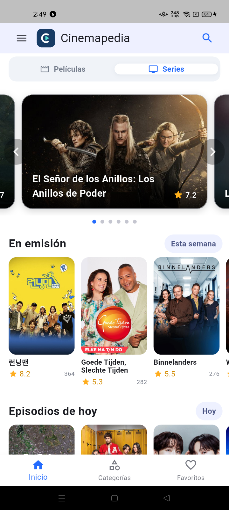
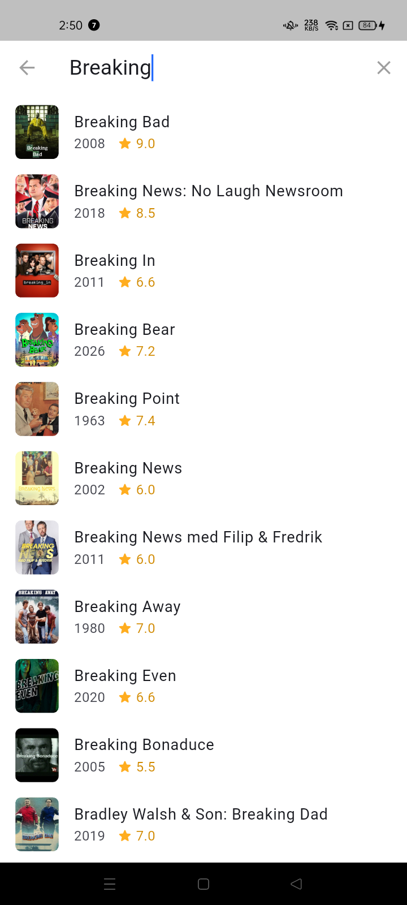
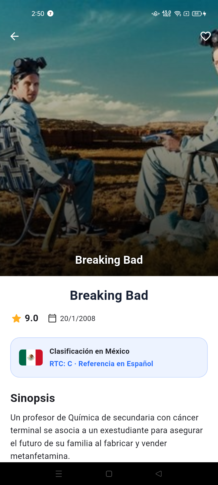
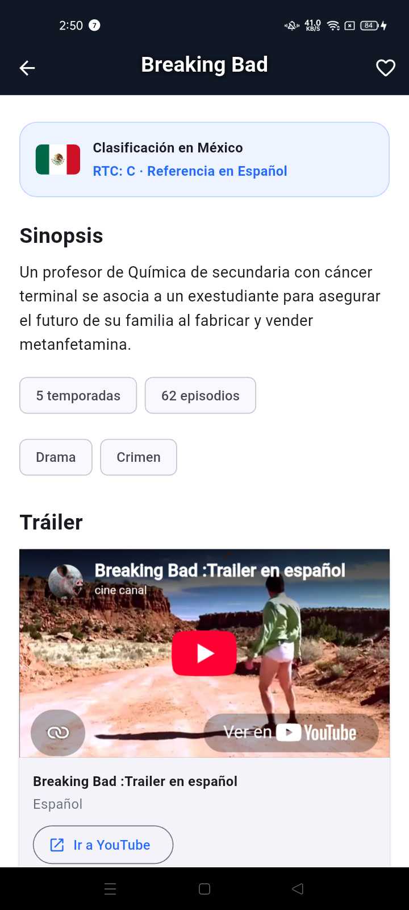

[**LINK APPETIZE — Probar Cinemapedia**](https://appetize.io/app/b_iuj4himrsqejzl7bokeypcy25m?device=pixel7&osVersion=13.0&toolbar=true)

# Prácticas de la Asignatura de Desarrollo Móvil Integral

## Ingeniería en Desarrollo y Gestión de Software

**Docente:** M.T.I. Marco A. Ramírez Hernández  
**Periodo:** Septiembre - Diciembre 2026
**Alumno:** Angel de Jesus Baños Tellez  
**Matrícula:** 230592
**Grupo:** 10A

---

### Tabla de Prácticas de la Materia

| No. | Nombre | Descripción | Potenciador | Estatus |
|---|---|---|---|---|
| 1. | Metodología de Evaluación de la Materia | Transcribir en libreta y comprender la metodología y fechas de evaluación de la asignatura | 5 | Concluida |
| 2. | [Mi Primera Aplicación Móvil con Flutter](hello_world_app/README.md) | Codificar una app móvil en Flutter manejando Stateless y Stateful Widgets | 25 | Concluida |
| 3. | [Yes No Maybe App](docs/practica-03/README.md) | App de chat en Flutter que consulta la API yesno.wtf, usa arquitectura por capas, inyección de dependencias, 18 pruebas y diagramas de arquitectura | 30 | Concluida |
| 4. | [TikTik](docs/practica04/tikitiki/README.md) | App de videos estilo TikTok con scroll vertical, provider, temas por temporada e iconos personalizados | 30 | En curso |
| 5. | [Práctica 05: Widgets App](docs/Practica-05/) | Catálogo Material 3 con GoRouter, Riverpod, animaciones y scroll infinito | 40 | Concluida |
| 6. | [Práctica 06: Cinemapedia](docs/practica06/README.md) | Catálogo de películas y series con TMDB, Riverpod, GoRouter, regiones, favoritos, reseñas locales y tráileres | 50 | Concluida |

---

### Práctica 06 — Cinemapedia: películas y series

Cinemapedia incorpora una sección de **Series** accesible desde el selector superior **Películas / Series**. Consulta TMDB para mostrar series en emisión durante la semana, episodios del día, títulos populares y mejor calificados. La búsqueda se adapta al tipo de contenido seleccionado.

- **Detalle de series:** portada, sinopsis, fecha de estreno, calificación, clasificación por país, géneros y número total de temporadas y episodios.
- **Contenido relacionado:** reparto, series similares y videos de YouTube, con prioridad para tráileres en el idioma seleccionado.
- **Favoritos y reseñas locales:** las series se identifican por tipo de contenido e ID para evitar mezclarlas con películas que tengan el mismo ID. Los favoritos usan Drift/SQLite y las reseñas SharedPreferences.
- **Navegación y estado:** detalle propio en `/series/:id`, pestañas Inicio, Categorías y Favoritos, y conservación del desplazamiento durante la sesión. Películas y Series mantienen posiciones independientes.
- **Región e idioma:** las consultas de series utilizan el idioma seleccionado y el detalle consulta la clasificación del país configurado.

Las temporadas y episodios se muestran como cantidades totales; la aplicación consulta información y tráileres, sin reproducir episodios completos. El catálogo requiere conexión a Internet y una clave de TMDB configurada en el `.env` de la práctica.

#### Evidencias de Series en el OPPO

Capturas reales obtenidas de la aplicación instalada en el **OPPO CPH2239** conectado por USB el **17 de noviembre de 2026**.

<table>
  <tr>
    <th>Inicio de Series</th>
    <th>Búsqueda de series</th>
  </tr>
  <tr>
    <td></td>
    <td></td>
  </tr>
  <tr>
    <th>Detalle de Breaking Bad</th>
    <th>Temporadas, episodios y tráiler</th>
  </tr>
  <tr>
    <td></td>
    <td></td>
  </tr>
</table>

La revisión en el dispositivo comprobó el acceso a Series, la carga del catálogo, la búsqueda de «Breaking» y la apertura del detalle de Breaking Bad con sus totales de temporadas y episodios y la vista previa del tráiler.

[Consultar configuración, arquitectura y documentación completa de Cinemapedia](docs/practica06/README.md).

---

### Manual de Desarrollo Móvil Integral

- [Consultar el manual](MANUAL/MANUAL_MOVIL_INTEGRAL_230592.pdf)

---

### Proyectos y diagramas de arquitectura

- [hello_world_app](hello_world_app/README.md) — Contador funcional en Flutter.
- [yes_no_app](docs/practica-03/README.md) — Yes No Maybe App en Flutter.
- [tikitiki](docs/practica04/tikitiki/README.md) — App de videos estilo TikTok en Flutter.
- [Cinemapedia](docs/practica06/README.md) — Catálogo de películas y series con TMDB, favoritos, reseñas y tráileres.

#### Diagramas interactivos

- [Práctica 03 — Arquitectura de Yes/No App](https://angeljdev.github.io/10A-DMI/practica-03/)
- [Práctica 04 — Arquitecturas de TikiTiki con Archify](https://angeljdev.github.io/10A-DMI/practica04/)
- [Práctica 04 — Demo Android de TikiTiki en Appetize](https://appetize.io/app/b_wy3wolryxw65vyzxisnpzln6ay)
